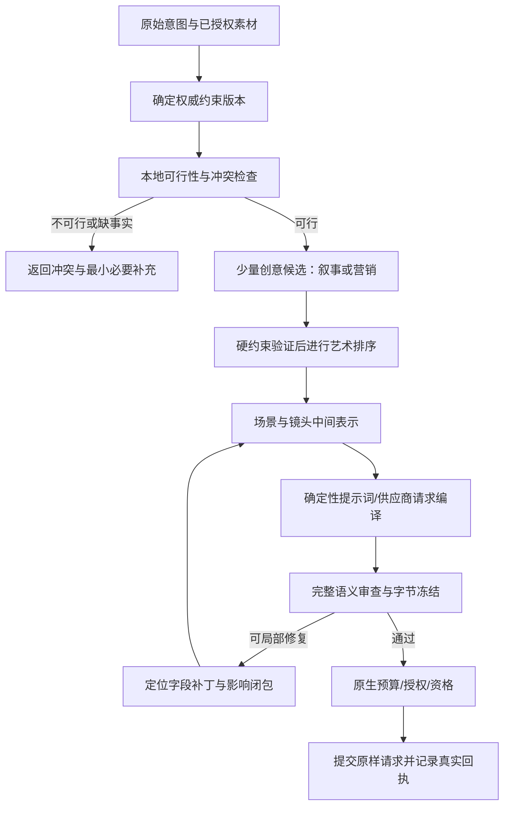

## 覆盖率声明

- 范围内文件总数：366；精读：121；机检/脚本解析：237；抽样：8；未读：0。
- 完整清单与各文件证据等级：`outputs/mine-clear/T-2026-1102-0001/coverage.json` 和 `scope-files.txt`；其中机检仅包括语法、引用、尺寸和散列，不代表理解全部实现。8 个抽样文件的读取范围和原因逐项保存在清单中。
- 为把深读集中在意图、权威合同、提示词融合、恢复和提交渲染边界，未把后期剪辑、发布、其他经营模块、全部传递依赖和素材库纳入此次精读。真实付费模型和渲染没有运行，效率与艺术收益仍需验证。

# 鹏经理 AI 视频渲染前管线：约束编译与局部创作方案

日期：2026-11-02（Asia/Shanghai）。状态：**待产品所有者对齐；本文方案未实施**。

本文与本轮缺陷修复分开。修复恢复既有合同的正确行为；下文涉及数据模型、执行器和创作方式的变化，须另开任务实施。A＝精读源码；B＝机器解析/测试范围；C＝抽样；D＝设计假设或尚未验证。

## 1. 要解决的产品问题

使用者是提出视频意图、承担渲染费用并对营销真实性负责的鹏经理操作者。用户需要在人物、商品、事实用途、平台、时长、声音、字幕、风格与商业目标等限制同时成立时，产出有表现力且可提交的作品。正确结果既要守住限制，也要保留创作空间；“没有违规”和“精彩”应分别取得证据。

建议把产品承诺定为：**先证明需求可行，再在可行空间内创作；确定违规必须拦，局部问题只修局部；提交渲染之前冻结并核对实际请求。** 不能承诺所有矛盾需求都自动生成、预审能保证供应商出片质量，或模型评分能保证营销转化。

三个具体场景：

1. 软件/服务营销：30 秒抽象信息片，不展示真实设备外观，客户给品牌色、旁白和已审文字。缺商品照片不应自动变成“不能制作信息片”，也不能让模型借抽象模式发明设备外观或运行效果。
2. 实物/人物营销：已授权模特和真实商品参考图，要求 24fps 横屏、原生声音和持续声明字幕。结构、身份和事实用途是硬边界，摄影、表演与节奏有创作自由；不能被通用模板改成无对白冷灰图形片。
3. 通用叙事：60 秒短片，其中 3 秒独立封面片头；某镜头第一次模型调用超时后恢复，或最后一个字段缺失。应保留前面合法成果，内容时长按 57 秒分配，单镜恢复成功后不因旧计数失败而整包作废。

功能必要性：若没有可行性检查，会把数学上不可能的要求送进长循环；若没有局部修复，单字段问题会扩大成整阶段重做；若没有创作评价，系统会收敛到稳定但平庸的模板；若没有完整请求冻结，预审通过的稿件可能与实际渲染不同。

非功能假设【D】：按本机单操作者、少量并行项目设计，继续一项目一有效执行租约；不引入跨区域调度和多人协作平台。每次模型/搜索/图像请求都有可信预算预占，未知用量不清零。具体吞吐和时延目标先从真实无敏感日志建立基线，本文不填未经实测的成功率。

## 2. 现状、衔接点与主要冲突

以下是代码事实【A】，不是生产速度测量：

| 现状 | 实现证据 | 对效率/正确性的含义 |
|---|---|---|
| G1 来源事实、G2 主题、G3 需求、G4 PRD 已有私有权威对象与 hash 绑定 | `marketing-authority.ts`、`requirement-authority.ts`、`prd-authority.ts` | 是应复用的基础，不应新建第二套事实源 |
| 后续多类模型调用会附上完整 G1/G2/G3/G4 资料与原裁决 | `prd-authority-bridge.ts` 的 `productionModelInput` 及模型 facade | 来源一致性强，但局部修复也重复携带大量上下文；调用数乘上下文体积后成本增加 |
| 营销 authority 制作模式禁用原生阶段/逐镜缓存 | `prd-authority-bridge.ts` 的 production bridge；`studio.ts` 的 `enableResume` 选项 | 缓存污染被挡住，但缺少同等可靠的受控局部复用时，恢复成本高 |
| 新 DAG、产物、门决定、repair playbook、操作账本已存在 | `packages/video-pipeline`、`packages/pipeline-control`、`video/pipeline/pipeline-repository.ts` | 可以继续建设，不能据此说实际创作已经按 DAG 逐节点运行 |
| 当前服务工作器里 off 之外的 coordinator mode 都装配 shadow observer，实际仍调用 `studio.runPreproduction` | `studio-worker.ts` 的 controlMode、runOnce 和 finally | 需要显式证明执行器切换；一个名为 enforce 的开关不等于完整新执行链已落地 |
| worker 外层重试粒度仍是 `preproduction`，默认不自动重跑，被拒后需明确重做策略 | `studio-worker.ts` 的 `VM_PRODUCER_RETRY`、`runOnce` | 当前守住了花费，但没有稳定的局部修复完成通道 |
| 最终请求有完整编译、签名资格、源字节复核、幂等与未知结果阻断 | `gen/compiled-request.ts`、`production-authority.ts`、`gen/submit.ts` | 必须保留，不能为了“更快出稿”绕过 |

本轮另有一个**发现未修的确定边界**【A】：真实 `prepareMarketingFacts` 可以装订无商品图片的抽象任务，随后 `extractProductVisualAuthority` 对显式 product 要求 A1 图片。明确“只抽象、不展示产品外观”的任务也会被拒。不能仅把 required 改为 false：当前下游会随之跳过商品外观检查，模型后续仍可能引入无依据外观。此处应以明确模式合同贯穿 G3/G4/G6，再把真实外观授权判为不适用；它属于本文需对齐的设计内容。

补充核心融合实现【A】：PromptFusionAgent逐镜串行执行；单镜内部重试、外层快速重试、BaseAgent分类重试、缺字段分组补齐与整包语义精炼叠加。不同提示模板存在字数下界和技术参数不一致，Phase3后还有字段展平、质检和再次改写。高层helper的callCounter不代表真实底层请求上界。这些行为见原生PromptFusionAgent、BaseAgent、ProductionEngine和宿主vendor-compat桥。

效率根因判断【D，基于上述 A 级事实的推断】：问题不只在模型遵循能力，而在同一约束被反复写成自然语言、各层又自行解释和改写；局部错误的责任范围与失效范围不稳定；艺术偏好、可确定合同与事后可测事项混在一套门里。仅加更长提示或更多重试，不能保证解除这些问题。

## 3. 候选方案与选择

| 方案 | 做法 | 优点 | 成本与风险 | 适用前提 |
|---|---|---|---|---|
| A：继续修补现有整体流程 | 保留多层全量上下文，用更精确提示、错误分类和缓存补丁降低失败 | 改动相对少，近期可见效 | 每增加一种规则仍要维护多处自然语言对齐；全量重做/上下文重复可能持续；模板容易继续侵蚀创作 | 规则规模小、需求变化慢，先止血 |
| B：约束编译 + 创作中间表示 + 局部修复，渐进接现有 DAG | 一次解释权威约束；生成只处理分配给本阶段的创作自由；机器检查、独立语义审查与艺术排序分层；仅重算受影响闭包 | 保留严格性，减少多处解释和无关重做；每个决定可追溯；通用/营销共享后段 | 需设计合同版本、失效图、缓存键与迁移；初期工程量较大；不能一次切全链 | 愿意以离线集和灰度证明收益，接受分阶段迁移 |
| C：加宽候选并发和模型投票 | 多模型或多候选全链生成后筛选 | 可能提高局部命中率 | 花费和尾延迟放大，同一矛盾会被重复生成；投票不证明事实与授权 | 有明确预算，约束已经可行且任务价值较高 |

**建议选择 B，以 A 中的确定缺陷修复作为前置；C 只在早期便宜的创意候选层按预算使用。** 不建议直接重写整个 vendor 或同时更换模型供应商。暂不引入新编排框架或新模型依赖，先复用现有控制包、存储和真实门禁。

工作量判断【D】：B 应拆为合同/检查、执行器、局部修复、评价灰度四个独立可回滚交付；每个阶段都需代码审计、失效/并发/恢复测试。没有逐文件拆卡前不给工期或价格承诺。

## 4. 约束分层：保留限制，消除不适用限制

每条约束至少有 `id/version/source/sourceRef/subject/predicate/severity/applicability/owner/repairScope/verificationMethod`。原始用户文字与事实字节独立保留，不能让模型悄悄改“用户说过什么”。约束的来源和覆盖关系记录在同一权威版本里。

| 层 | 例子 | 判断与处理 |
|---|---|---|
| 不可自动放宽的边界 | 权利/真人授权、事实用途、租户、预算、禁止重复付费、供应商硬能力 | 缺失/冲突就明确 blocked，创作器不能修改 |
| 客户明确合同 | 30 秒、横屏、人物、旁白、品牌色、持续字幕、允许/禁止的实物外观 | 必须保留；硬矛盾返回具体冲突，不能“最接近”后静默放行 |
| 可确定制作合同 | 场景上下界、时长守恒、字段类型、引用完整、字节 hash、provider 限额 | 本地验证器裁决，失败定位到字段/镜头 |
| 创作软目标 | 钩子强度、情绪弧线、节奏、新颖性、品牌气质 | 在满足硬约束的候选中排序；普通改进建议不自动升级成硬拦截 |
| 渲染后才能测的事项 | 真实人物一致性、最终可读性、响度、成片时长与供应商实际画质 | 渲染前做可行性与风险预估，明确“未验证”；不伪造预审已证明真实媒体 |

不适用必须有证据。例如 `cast.mode=none` 可以使人物定妆照检查不适用，但不能自动推出无旁白；`visualMode=abstract_without_product_appearance` 使真实外观参考要求不适用，同时必须启用“不得生成产品外观”的合同。`subtitleMode=sidecar` 与屏上图形文字是两种对象，不能相互替代。

条件 schema 可以表达条件必填/禁止字段，但它只解决结构，不证明事实或艺术质量。[JSON Schema 官方条件验证说明](https://json-schema.org/understanding-json-schema/reference/conditionals)。使用当前供应商的结构化输出能力前必须验证其支持的 schema 子集；不把本地合法 schema 当成云端必然支持。

## 5. 推荐主流程

编译阶段先核对：内容时长 = 最终时长 − 实际封面片头；每类节点实际 schema 的上下界是否存在可行分配；台词、停顿和动作是否能落进时间轴；平台/画幅/供应商是否兼容；真实外观/无外观模式、字幕、参考和声音是否互相矛盾。没有可靠速度模型的语义负载只报告风险，不能编一个“精确最低秒数”。

可行性输出至少有 `feasible|blocked|needs_input`、`constraintVersion`、确定冲突列表、依据、可行动建议。对于复杂逻辑先使用明确规则而非一上来做通用求解器；所谓“最小冲突集”只在确有算法证明时称最小，否则写“已定位冲突子集”。系统可以自行选择镜头数、分配自由字段与执行顺序；客户明确意图、授权、预算缺失等不能自行补造。

通用/营销的分流：通用不消费营销 G1 authority；营销在共同创作前增加当前来源事实和用途合同。进入共同制作后，共用场景/镜头表示、提示编译与资格冻结。marketing 的 production/render 子图调用必须声明明确 entry/exit、输入输出角色和已完成边界，不能两次调用同名 narrative 子图却靠注释推断只运行一半。

### 5.1 让 N 个限定落在正确层级，而非每镜同时塞满

约束须标注作用域。画幅、授权、产品身份和禁止事实属于全片不变量；两个核心卖点可以是“全片各覆盖一次”；情绪转折属于相邻场景关系；运镜和动作通常属于单镜。编译器生成 coverage matrix，将必须表达的信息分配到明确镜头，验证全片覆盖和跨镜一致性。除非客户明确要求常驻，每条卖点、来源脚注和CTA不必每镜重复。

以一个待设计示例【D】说明：最终30秒含5秒封面，则内容25秒；内容可分为5秒钩子、8秒冲突/需求、7秒可核事实及其表现、5秒收束。这个例子只是合法时间分配候选，不预先指定每次都四镜，也不宣称适配所有模型。每镜只承担一个主要信息任务，硬约束仍跨镜成立。

同一合法合同下可探索三种不同创意：用“缺口逐渐闭合”的空间隐喻组织信息；用“同一主体前后不同状态”形成悬念；用“问题—反差—可核事实”构建短叙事。若客户只授权抽象无外观模式，所有表现都须停留在示意层，不把隐喻写成真实产品效果或竞品比较。颜色、音乐、节奏与参考方向由客户约束和创作候选决定，不能统一替成冷灰静音。

艺术评审按信息可读性、钩子与后文兑现、情绪推进、画面差异、品牌契合与新颖性分别给出依据和排序；对“精彩”的意见可以保留分歧。候选必须先满足同一硬合同，不能用更高艺术分抵消事实违规，也不能把低分建议无限转成重生成命令。

## 6. 创作中间表示及提示词编译

建议沿用现有 RequirementContract.scenes 和 ArtifactEnvelope，补齐单个 `CreativeShot` 的稳定字段：镜头/场景 ID、叙事目的、信息任务、被授权 claim ID、主体、动作、时间区段、构图/运动意图、声音意图、文字图层、引用资产及来源、适用约束 ID、自由创作字段、版本与父 hash。

制作结构应由宿主负责：技术规格、时长、字段命名、引用格式、字幕模式、模型硬上限和授权绑定。模型负责：在给定合同内选择具体画面、动作、情绪、节奏与转场。不能要求模型反复创作帧率、来源地址或已冻结场景总时长，也不能把固定 30 字段齐全等同于艺术完成。

提供给单镜创作器的输入为当前约束切片、镜头/前后镜必要关系、相关事实原件和完整可追溯引用。**减少重复传输不等于只给摘要**：事实证据仍应能完整取得；没有工具读取能力的模型调用仍传所需完整原文。不能用 hash 替代模型实际看到的内容。供应商支持的缓存能力若可用，只作为传输优化，不能替代本地版本/费用审计。

编译器只确定性排版和派生字段，不能发明对白、许可、材质、销量或其他语义。最终业务语义发生任何改动都生成新 artifact/revision 并使受影响审核失效。选定创意没有被客户指定模板覆盖时，编译器不能把它重新改成另一套冷灰画面。

## 7. 检查、修复与停止条件

硬约束先本地验证；事实/语义审查读取候选及真实依据；艺术评审在合法候选之间排序。起草调用和终审调用独立运行、绑定同一版本；继续沿用现有模型路由，不以跨供应商 fallback 隐式改变业务合同。多个评委一致也不代替确定性检查。

修复结果统一为：`finding.code/targetId/fieldPath/expected/actual/evidence/ownerStage/allowedChanges`。允许确定性结构修复、同一镜头局部字段补丁、单镜重新创作；禁止修改原始事实、已审上游、用户明确约束、门槛和未点名镜头。补丁必须比对实际 diff，而非信模型自述“只改了这个字段”。

建议初始策略【D，待离线校准】：每镜最多 2 次模型修复；同一 finding 签名重复且无进展立即停止；一个项目另有总调用数/输入输出 token/最坏费用/墙钟的硬上限。所有模型、搜索和重试在调用前预占可信上界；未知用量保留预占且冻结继续付费。次数少不自动等于费用有上界，输入、供应商内部重试和多步调用都须计入。

修复先复制候选，完整验证后原子提交，乐观锁比较 run/stage revision；若并发变更只重读/重新评估，不盲目重发模型或渲染。修复中断保留合法旧产物与新失败证据。供应商 accepted/unknown 不进入创作修复，先按原 task/请求回执调和。

研究只为此设计提供方向依据：有研究将“找到错误”与“知道位置后修复”分开实验，支持对外部定位反馈做专项评估；这不是对当前模型或视频创作效果的保证。[Tyen 等，ACL Findings 2024](https://arxiv.org/abs/2311.08516)。本系统必须用自己的基准证明局部定位是否有效。

## 8. 数据模型与索引提案

继续复用 `video_pipeline_runs/production_stage_runs/video_artifacts/video_gate_decisions/video_gate_findings/video_repair_plans/video_pipeline_operations`，不另建平行运行事实源。以下新增/扩展均为提案，未迁移：

| 对象 | 关键字段 | 约束/索引 |
|---|---|---|
| contract revision | tenant/workspace/project/id/revision、rawIntentSha、factManifestSha、constraintJson、schema/policy/model版本、contractHash、supersedes | 同项目revision唯一；workspace+project+contractHash索引；只追加 |
| constraint entry | contractRevisionId、constraintId、sourceRef、subject、predicate、hardness、applicability及依据、ownerStage、allowedRepairPaths | contract+constraintId唯一；按ownerStage/subject查询；不能由模型提升授权 |
| creative candidate | run/stage/item、candidateId、parentArtifactHash、contractHash、creativeJson、hardCheck、artScore与rubricVersion | run+stage+item+candidate唯一；只在同合同和可比rubric下排名 |
| verdict detail | decisionId、constraintId、evidenceRef、status、reason、fieldPath、measured/inferred、cost回执 | decision+constraint唯一；未验证与不适用分开 |
| repair attempt | repairPlanId、attempt、baseRevision、before/afterHash、actualDiff、budgetReservationId、outcome、findingSignature | plan+attempt唯一；原子CAS；未知预算不能清零 |

所有对象作用域由数据库外键、RLS和事务上下文同时限制；缓存键至少绑定tenant/workspace、上游artifactHash、合同/schema、模型/提示/策略版本与配置。缓存命中需重新验证权利有效期、当前硬门和来源字节。合法缓存不代表当前模型重新生成过。

## 9. 接口提案

沿用当前 tRPC `video.studio` 风格；下列为拟新增接口，而非已经上线的 URL：

| 方法 | 主要输入 | 返回 | 错误/失败路径 |
|---|---|---|---|
| `compileIntent` | projectId、原意图引用、metadata版本、事实manifest、expectedRevision、idempotencyKey | contractId/revision/hash、constraints、feasibility、conflicts、estimates | FACT_EVIDENCE_MISSING、CONSTRAINT_CONFLICT、REVISION_CONFLICT |
| `creativeCandidates` | runId、contractHash、count、budgetEnvelope、idempotencyKey | candidateIds、状态、费用预占/未知 | BUDGET_UNPROVABLE、BUDGET_EXHAUSTED；不启动未获预算调用 |
| `repairPreview` | decisionId、target item、expectedStageRevision | allowed/forbidden changes、invalidationClosure、预算上界 | NO_REPAIR、SOURCE_STALE、PATCH_SCOPE_VIOLATION |
| `applyRepair` | repairPlanId、planHash、版本、idempotencyKey | 新artifact revision、重验队列或明确blocked | CAS冲突、REPAIR_BUDGET_EXHAUSTED；不改变原授权 |
| 当前资格签发/提交入口 | 当前artifact/完整请求/原生身份与预算 | 已签资格、准确task/回执或unknown | 继续保留QUALIFICATION_*、SUBMISSION_UNKNOWN等现有语义 |

发现需求缺少必需信息时，返回明确缺项和已完成工作；不让用户选择可自动决定的实现细节。进度面展示“正在创作哪一镜、哪条约束失败、还剩几次局部修复、预算已知/未知、是否已提交”，不能把内部文件名/栈当作用户主流程。

## 10. 分期、验收与回滚

P0：约束版本与适用性；final/content时长统一；当前schema可行性；无外观/有外观明确模式；结构与事实硬门；单镜finding与实际diff检查；完整请求冻结；确定预算与未知结果恢复。缺少任何一项都不能证明严格且可自主完成。

P1：早期少量创意候选；合法候选艺术排序；受控缓存/局部重验；详细成本与失效解释；项目取消/重启接续。它们用于减少反复等待和同质化。

P2：按项目价值配置候选数量、离线学习修复策略、艺术评价校准看板。没有基线前不做自动调门槛或跨供应商投票。

实施次序：

1. 建立离线基准与现有链对照，先记录现状失败类别，不更改生成行为。
2. 约束编译以 shadow 输出，与现行门逐条比较，特别统计错误放行/误拒；shadow失败不能污染生产状态。
3. 先迁移无外观抽象任务一个小范围，再迁移明确实物任务和通用任务；每一类分别验证，不能用软件片成功证明真人片安全。
4. 逐节点接入新执行器与局部修复；每个adapter以能力和实际回执验收，子图边界显式。新旧同项目只能一个执行者，不能双跑付费链。
5. 最后再考虑减少重复语义审核；必须先证明同一约束已在完整依赖闭包中验证且未失效。预算、授权、事实和实际请求检查继续保留。

离线最小矩阵【D】：两条路线 × 五类约束组合 × 六种扰动 = 60 案例；扰动至少包含正常、空/边界、冲突、超时/失败、并发改版、重启/未知费用。另加本轮所有回归反例。每例记录前置、步骤、期望/实际、模型/提示/源hash、费用与完整输出。确定性合同错误放行必须为0，已成功任务重复提交必须为0，所有失败都要准确终态。真实艺术和效率比较再各路线取至少30个有代表性的授权案例，报告样本量、置信区间与失败案例；不是事后只统计成功任务。

指标定义：首次生成硬合同通过率、预算内完成率、用户主动需求修改以外的人工介入率、p50/p95到可提交时间、每个合法交付的模型费用、未解决未知费用、整阶段重做比例、硬门误拒/漏放、盲评艺术胜率和事实违规率。建议目标是较对照链减少无效重做、缩短尾延迟且不提高违规；具体阈值在基线后共同冻结，本文不把愿望写成已达标数字。

回滚：关闭新adapter/模式开关，新项目回旧链；正在运行项目按其固定plan/schema继续或明确停止，不能半途混用。已成功媒体、已接受/未知供应商任务和费用账本只读保留；通过新修订/revert修复代码，不删除历史。数据库变更采用先扩展后迁移，旧读端可继续读取既有版本。

## 11. 不做什么与需要对齐的决定

范围外另有入口观察【C】：第三条口播解说管线在独立studio入口和threads.dispatch入口的执行器衔接不同，dispatch当前仍可能按narrative启动；本轮用户点名通用/营销两线，未扩展为第三线执行器改造。路由标签与metadata的连带修复不代表第三线完整执行链已验收。

本方案不承诺渲染前识别所有画质/表演问题，不代替真人/素材授权，不生成假事实，不保证营销转化，不自动提高预算，不通过删除门或把所有建议降为软项求通过，也不直接重写整个vendor或引入跨模型平台。

建议对齐四件事：选择B的渐进方向；认可硬约束/创作软目标/渲染后实测分层；认可无外观抽象模式要有禁止外观的完整合同；冻结基准与允许灰度范围后再实施。其余文件组织、具体代码与测试拆分由工程执行自主完成。

## 收尾报告

- 已完成：结合本轮源码证据提出两主方案及一补充方案，选定B；给出三个场景、核心流程、P0/P1/P2、数据/接口/异常/预算/迁移/验证/回滚细节。
- 未完成/未覆盖：本方案尚未实施或真实模型验证；无图抽象任务的视觉模式冲突按用户先对齐要求保留为待设计项。
- 自主追加事项及理由：补充创作艺术评估与硬合同检查的分工，避免“符合字段规范”替代作品质量。
- 采用的假设：本机单操作者、少量项目并行；复用现有数据库/控制包/模型路由；阈值需基线后确定。
- 置信度：现状代码分析高；未来效率和艺术收益中，必须通过对照集与灰度验证。
- 建议复核：第4节约束分层、第7节局部修复边界、第10节迁移和验收条件。

## 自检表

- [是] 覆盖两条渲染前管线的方案范围，明确不扩展渲染后整链。
- [是] 实施选择自行分析并给出建议，按用户要求保留方案确认边界。
- [是] A级现状与D级设计/目标分开，未将研究或schema合法性冒充生产效果。
- [是] 给出数据、接口、错误、并发、预算和回滚，支持工程逐项评审。
