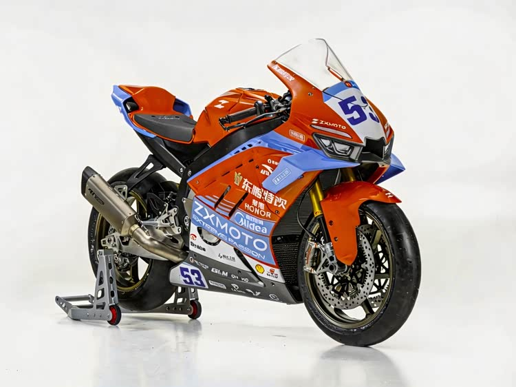
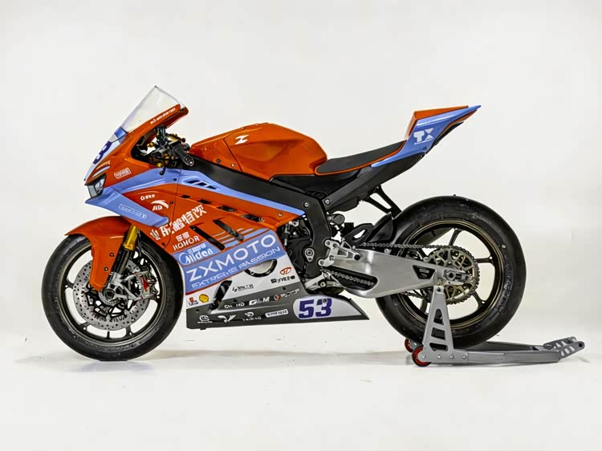

# 张雪机车 820RR-RC 赛道版

本档案由系统正式“情报五站”采集和装订，再由 `product-archive.mts from-research` 入库。型号为 **820RR-RC**；商品与[品牌/创始人档案](../zxmoto/README.md)分别保存，避免把其他车型的赛事成绩或参数移到 RC 上。

上图是正式出片主图，原始尺寸 **750×562**；下图为同组左侧整车。两张均保持发布原字节，属于中等清晰度的白底外观参考。

## 档案内容与使用

- 正式档案：[profile.json](profile.json)，8 张图片、33 项逐项来源事实；轴距与座高保留有源单位换算，供比例约束使用。
- 研究回执：[research-import.json](research-import.json)，包括本次来源 SHA、事实 claim ID、引文位置与 SHA、独立审核及逐图来源配对。
- 五站原始装订：[dossier.json](research/dossier.json)；摘要卡：[summary-cards.json](research/summary-cards.json)。两份均保留正式链路原字节，真实缺口没有删除。
- 来源审核：[审核摘要与保留意见](research/support-review-summary.json)，逐值保留本次真实模型结论、问题与建议，不产生人工或生产批准。
- 附加图库：[研究附图索引](research/reference-index.json)，25 张摩托范原图集记录和 1 张低于正式字节门槛的尾部细节图。研究附图不在 `photos[]`，不会自动作为正式出片输入。
- 来源筛选：[source-assessment.json](research/source-assessment.json)，记录 RS 混图、分辨率、重复画面与缺证据阶段的边界。

本车的来源资料注明赛道用途及道路行驶限制。正式图库同时包含白底参考、发布现场证据和宣传/参数图，选片时按用途区分；主图使用白底整车，不拿发布海报直接当生成视频。

## 逐项来源资料

以下内容按正式研究产物展示，保留报道口径；型号参数、指导价和时间信息需要在实际投放前核对。不得把资料收录当作厂商确认、最新成交价或使用效果保证。

| 资料项 | 来源记录的内容 | 原文出处 |
|---|---|---|
| 研究身份.name | 张雪 820RR-RC 赛道版 | [来源原文](https://www.ithome.com/1/004/414.htm) |
| 研究身份.brand | 张雪机车 | [来源原文](https://www.ithome.com/1/004/414.htm) |
| 研究身份.category | 摩托车 | [来源原文](https://finance.sina.com.cn/wm/2026-09-19/doc-inisispz2576147.shtml) |
| 研究身份.model | 820RR-RC | [来源原文](https://www.ithome.com/1/004/414.htm) |
| 价格[1].amount | 128000 | [来源原文](https://www.ithome.com/1/004/414.htm) |
| 价格[1].currency | 元 | [来源原文](https://www.ithome.com/1/004/414.htm) |
| 价格[1].note | 2026年9月19日报道的全国统一指导价 | [来源原文](https://www.ithome.com/1/004/414.htm) |
| 发动机 | 818.8cc 直列三缸发动机 | [来源原文](https://www.ithome.com/1/004/414.htm) |
| 配气结构 | DOHC 每缸四气门 | [来源原文](https://www.ithome.com/1/004/414.htm) |
| 冷却方式 | 水冷 + 油冷散热结构 | [来源原文](https://www.ithome.com/1/004/414.htm) |
| 最大功率 | 113 千瓦，在每 13500 转时输出 | [来源原文](https://www.ithome.com/1/004/414.htm) |
| 最大扭矩 | 86 牛 · 米在每 10000 转时产生 | [来源原文](https://www.ithome.com/1/004/414.htm) |
| 最高转速 | 最高转速可达 14750 转 | [来源原文](https://www.ithome.com/1/004/414.htm) |
| 压缩比 | 14:1 | [来源原文](https://www.ithome.com/1/004/414.htm) |
| 供油系统 | BOSCH 电喷 | [来源原文](https://www.ithome.com/1/004/414.htm) |
| 电子油门与弹射起步 | 配备电子油门和弹射起步功能 | [来源原文](https://www.ithome.com/1/004/414.htm) |
| 排气系统 | 钛合金直排排气系统 | [来源原文](https://www.ithome.com/1/004/414.htm) |
| 换挡机构 | 反挡换挡机构 | [来源原文](https://www.ithome.com/1/004/414.htm) |
| 快速换挡 | 双向快速换挡装置 | [来源原文](https://www.ithome.com/1/004/414.htm) |
| 仪表 | 6.2 英寸 TFT 赛道仪表 | [来源原文](https://www.ithome.com/1/004/414.htm) |
| 前悬架 | KYB 品牌组件，43 毫米倒置式减震器，支持全段调节，配备锻造 CNC 底筒和 DLC 叉管 | [来源原文](https://www.ithome.com/1/004/414.htm) |
| 后悬架 | 多连杆结构，同样支持全段调节，预载可免工具调节 | [来源原文](https://www.ithome.com/1/004/414.htm) |
| 制动系统 | Brembo 提供，前轮 PRO1 四活塞径向卡钳配合 330 毫米双浮动盘，搭配 Brembo RCS 直推泵，后轮 P34 双活塞卡钳与 220 毫米浮动盘组合 | [来源原文](https://www.ithome.com/1/004/414.htm) |
| 转向角 | 20 度 | [来源原文](https://www.ithome.com/1/004/414.htm) |
| 前倾角 | 24.6 度 | [来源原文](https://www.ithome.com/1/004/414.htm) |
| 拖曳距 | 104.2 毫米 | [来源原文](https://www.ithome.com/1/004/414.htm) |
| 轴距 | 1420 毫米 | [来源原文](https://www.ithome.com/1/004/414.htm) |
| 轮胎规格 | 前 120/70 ZR17、后 180/60 ZR17 | [来源原文](https://www.ithome.com/1/004/414.htm) |
| 轮辋 | 锻造 CNC 材质 | [来源原文](https://www.ithome.com/1/004/414.htm) |
| 座高 | 825 毫米 | [来源原文](https://www.ithome.com/1/004/414.htm) |
| 油箱容积 | 16 升 | [来源原文](https://www.ithome.com/1/004/414.htm) |
| 湿重 | 160 公斤 | [来源原文](https://www.ithome.com/1/004/414.htm) |
| 用途限制 | 赛道专用车辆，不具备道路行驶资质，主要针对赛道日及竞速场景使用 | [来源原文](https://www.ithome.com/1/004/414.htm) |

## 正式图片

| 图片 | 实际尺寸 | 登记角度 | 原始来源页 |
|---|---|---|---|
| [sina-release-8](photos/01-sina-release-8.jpg) | 1080×810 | detail | [原文](https://finance.sina.com.cn/wm/2026-09-19/doc-inisispz2576147.shtml) |
| [chejiahao-1](photos/02-chejiahao-1.jpg) | 750×562 | three-quarter | [原文](https://chejiahao.m.autohome.com.cn/pingan/chejiahao/detailinfo/26640213) |
| [chejiahao-2](photos/03-chejiahao-2.jpg) | 750×562 | side | [原文](https://chejiahao.m.autohome.com.cn/pingan/chejiahao/detailinfo/26640213) |
| [chejiahao-5](photos/04-chejiahao-5.jpg) | 750×562 | detail | [原文](https://chejiahao.m.autohome.com.cn/pingan/chejiahao/detailinfo/26640213) |
| [chejiahao-6](photos/05-chejiahao-6.jpg) | 750×562 | detail | [原文](https://chejiahao.m.autohome.com.cn/pingan/chejiahao/detailinfo/26640213) |
| [rc-release-01](photos/06-rc-release-01.jpg) | 1200×1881 | three-quarter | [原文](https://www.ithome.com/1/004/414.htm) |
| [rc-release-02](photos/07-rc-release-02.jpg) | 1200×3158 | side | [原文](https://www.ithome.com/1/004/414.htm) |
| [rc-release-03](photos/08-rc-release-03.jpg) | 1200×2961 | detail | [原文](https://www.ithome.com/1/004/414.htm) |

4 张白底图为 750×562，1 张发布现场图为 1080×810，3 张宣传图宽 1200。没有把小图放大或删除水印。研究附图中的 `2361062` 虽由来源标作“俯视”，实际与 `2361056` 正前图字节相同，已单列问题，不计为新增角度。

## 事实与权限状态

来源状态为 `system-generated / priority=1 / pending-owner-review`。图片仅记录公开来源和真实外观参考，商用授权未经确认；本档案不产生创始人背书、G1 人工审批或生产发布资格。

没有获得可核实用户评价或直接竞品证据，因此档案不提供评分、销量、使用效果共识或竞品优劣结论。当前正式入库是显式 `from-research` 命令；Studio 自动情报采集与出片缺档案后的自动补档仍是不同环节。
