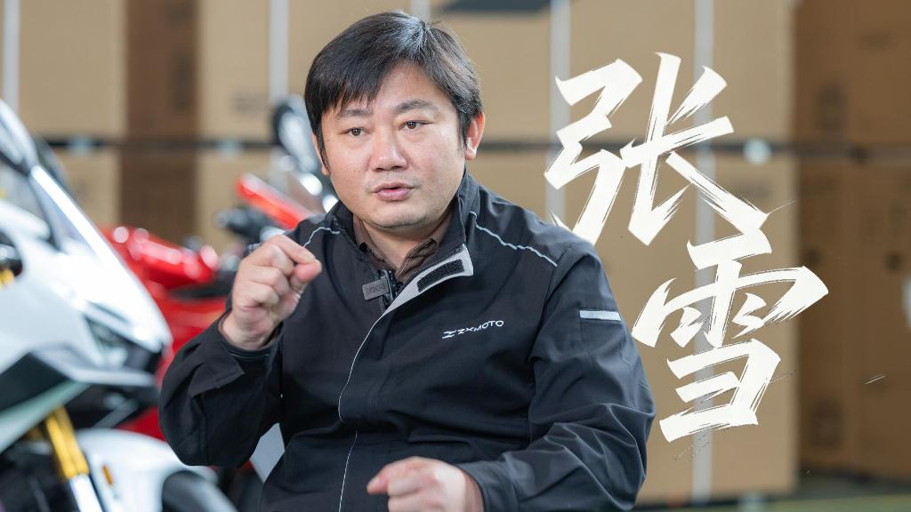

# 张雪机车与创始人张雪

本档案补充[820RR-RC 商品档案](../zxmoto-820rr-rc/README.md)的品牌背景。内容来自公开采访与报道，经正式“情报五站”逐项来源核验和独立审核；公司/人物事实与具体车型参数分开保存。

## 品牌与人物资料

以下是正式研究提取的简短事实与观点转述，完整新闻正文和长引文只保留在本地研究证据中。读者可通过每项来源阅读原报道。

| 资料项 | 来源记录的内容 | 原文出处 |
|---|---|---|
| 研究身份.name | 张雪机车 | [来源原文](https://people.cctv.com/2026/04/03/ARTI87gL7UfrOvClXrfU9Xli260403.shtml) |
| 研究身份.brand | 张雪机车 | [来源原文](https://people.cctv.com/2026/04/03/ARTI87gL7UfrOvClXrfU9Xli260403.shtml) |
| 创始人 | 张雪 | [来源原文](https://people.cctv.com/2026/04/03/ARTI87gL7UfrOvClXrfU9Xli260403.shtml) |
| 创立时间 | 2024年4月 | [来源原文](https://people.cctv.com/2026/04/03/ARTI87gL7UfrOvClXrfU9Xli260403.shtml) |
| 创立地点 | 重庆 | [来源原文](https://people.cctv.com/2026/04/03/ARTI87gL7UfrOvClXrfU9Xli260403.shtml) |
| 研发方向 | 专注高性能产品和自主发动机研发 | [来源原文](https://people.cctv.com/2026/04/03/ARTI87gL7UfrOvClXrfU9Xli260403.shtml) |
| 2025年总产值 | 7.5亿元 | [来源原文](https://people.cctv.com/2026/04/03/ARTI87gL7UfrOvClXrfU9Xli260403.shtml) |
| 创始人出生地 | 湖南怀化偏远山村 | [来源原文](https://cpc.people.com.cn/n1/2026/0512/c64387-40718001.html) |
| 创始人早年经历 | 辍学进入修理铺当学徒 | [来源原文](https://people.cctv.com/2026/04/03/ARTI87gL7UfrOvClXrfU9Xli260403.shtml) |
| 创始人技能 | 可蒙眼组装发动机 | [来源原文](https://cpc.people.com.cn/n1/2026/0512/c64387-40718001.html) |
| 人物观点 | 我认为行业上下游会更有信心 | [来源原文](https://people.cctv.com/2026/04/03/ARTI87gL7UfrOvClXrfU9Xli260403.shtml) |

## 图片与关联

| 图片 | 实际尺寸 | 登记角度 | 原始来源页 |
|---|---|---|---|
| [sina-release-1](photos/01-sina-release-1.jpg) | 1080×810 | front | [原文](https://finance.sina.com.cn/wm/2026-09-19/doc-inisispz2576147.shtml) |
| [sina-release-9](photos/02-sina-release-9.jpg) | 1080×608 | front | [原文](https://finance.sina.com.cn/wm/2026-09-19/doc-inisispz2576147.shtml) |
| [founder-xinhua-portrait](photos/03-founder-xinhua-portrait.jpg) | 1024×576 | front | [原文](https://people.cctv.com/2026/04/03/ARTI87gL7UfrOvClXrfU9Xli260403.shtml) |

图片为公开采访/发布会报道中的原始画面。用于品牌研究与选题参考，不表示张雪本人授权本项目代言，不合成其声音或真人出镜。

- 商品关系：`relations.products = ["zxmoto-820rr-rc"]`。
- 正式档案：[profile.json](profile.json)；本次研究回执：[research-import.json](research-import.json)。
- 五站原始装订：[dossier.json](research/dossier.json)；摘要卡：[summary-cards.json](research/summary-cards.json)。
- 来源审核：[审核摘要与保留意见](research/support-review-summary.json)，保留本次真实结论及全部问题、建议。
- 状态：`system-generated / priority=1 / pending-owner-review`；没有确认素材商用授权，也没有取得人工生产或发布批准。
- 关于 RS 的赛事与性能信息不会转写成 RC 的产品成绩；本公司档案不含具体车型的排量、加速或功率表。
